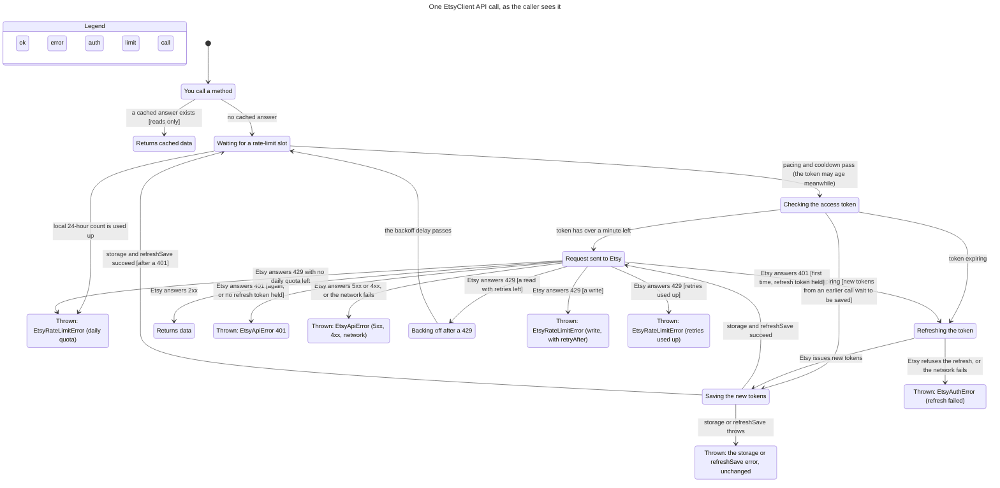

# Statechart: one EtsyClient API call

This folder holds a small TLA+ model of what an SDK user sees when they call an
`EtsyClient` method. It covers token checks and refresh, saving rotated tokens,
rate-limit pacing, 429 retries, and the error each failure throws. The chart is
drawn from the model by the `statechart` skill in pstack. Its purpose is to let
the owner check that the model matches how the client should behave.

| File | What it is |
|---|---|
| `EtsyClientCall.tla` | The model. Each action cites the code it follows. |
| `EtsyClientCall.cfg` | TLC config: `MaxRetries = 2` and the rules checked. |
| `view.mjs` | Labels for states and arrows, in the caller's words. |
| `chart.mmd` | Generated Mermaid statechart. |
| `chart.svg` | `chart.mmd` rendered with Pele. |
| `report.md` | Generated TLC report: rules that hold, rules that break, and the shortest path to each break. |

## Chart



No rule breaks, so no state is marked.

## Rules

All rules hold: `NoExpiringTokenSent`, `NoUnsavedTokensUsed`,
`WritesNotReplayed`, `RetriesBounded`, `RateLimitErrorsAreTyped`,
`AuthErrorOnlyWhenReauthNeeded`, `TypeOK`, `NoDeadlock`.

- **`NoExpiringTokenSent`**: no request leaves with a token about to expire.
  The client reads the token after each rate-limit wait (`sendAuthorized`),
  and the model lets the token age while the call waits, so the wait and the
  429 backoff are covered.
- **`AuthErrorOnlyWhenReauthNeeded`**: "You only see a 401 when re-authorising
  is the only fix." On the first 401, when a refresh token is held, the client
  refreshes once and resends once (`recoverFromUnauthorized`). A second 401,
  or a 401 with no refresh token, is thrown as `EtsyApiError 401`. A failed
  refresh throws its `EtsyAuthError`.
- **`RateLimitErrorsAreTyped`**: "Every rate-limit failure is an
  `EtsyRateLimitError`." A 429 on a write is still not replayed, but it now
  throws `EtsyRateLimitError` with `retryAfter` (`writeRateLimitError`).
- **`WritesNotReplayed`**: a write reaches Etsy once, or twice when the first
  send got a 401 (Etsy did not act on it). It is never replayed after a 429.
- **`RetriesBounded`**: sends stop at `maxRetries + 1`, plus one resend after a
  401.

If saving rotated tokens fails, the caller gets the error that
`storage.save` or `refreshSave` threw, unchanged. It is not wrapped in
`EtsyAuthError`: `persistRefreshedTokens` has no catch, and the request loop
passes token errors through.

## What the model leaves out

- The OAuth authorisation step (`AuthHelper`). The model starts with tokens
  already held.
- Concurrency: many calls sharing one refresh promise, out-of-order rate-limit
  headers, and the guarded single quota probe in `EtsyRateLimiter`.
- The proactive rotation scheduler, `clearTokens`, `updateTokens` and manual
  `refreshToken()`.
- Calls that use `fetchOnceWithRateLimit` (uploads and
  `updateListingProperty`) instead of the retry loop. They follow the same
  token, 401 and write-429 rules as a write, and are covered by unit tests.
- `rateLimiting.enabled = false`. In that mode slots are not reserved, but
  GET 429s are still retried.
- Exact delays, jitter and `Retry-After` arithmetic. Time is reduced to
  "token fresh / token expiring" and "backoff passes".
- Exact elapsed time. Time passing is reduced to "the token may start
  expiring while the call waits for a slot".
- Concurrent calls that hit a 401 together. The client refreshes only if the
  rejected token is still current; otherwise it resends with the new token.
- The model assumes that a refresh token Etsy has just issued works.

## Open questions

- Should a failure to save rotated tokens be wrapped in `EtsyAuthError`, or is
  passing the storage error through unchanged the intended contract?

## Regenerate

1. Enable the **pstack (Claude Code port)** plugin from the
   `henrypitmandigital/agent-skills` org marketplace.
2. From this folder, run the skill's script (it needs Node 22.18+, Bun or Deno):

   ```sh
   <plugin dir>/skills/statechart/scripts/statechart EtsyClientCall.tla \
     --config EtsyClientCall.cfg --view view.mjs --out /tmp/etsy-statechart
   ```

   On its first run the script installs TLC and Java with `mise`. Without
   `mise`, download `tla2tools.jar` from the TLA+ releases and set
   `TLA2TOOLS=/path/to/tla2tools.jar JAVA=/path/to/java` before the command.
3. Copy `chart.mmd` and `report.md` from the `--out` folder back here. To
   rebuild `chart.svg`, follow the skill's `references/render.md` (it uses
   `pele@1.9.0`).

When the client's auth, retry or rate-limit code changes, update the matching
action in `EtsyClientCall.tla` and regenerate.
