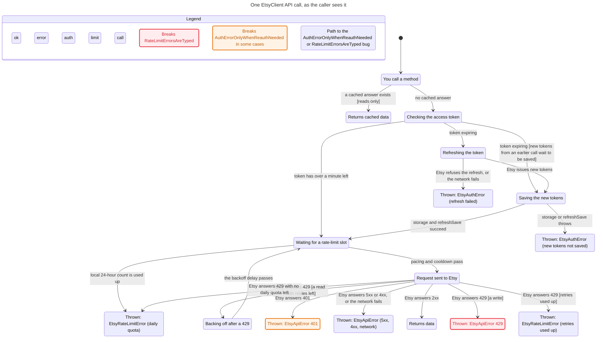

# Statechart: one EtsyClient API call

This folder holds a small TLA+ model of what an SDK user sees when they call an
`EtsyClient` method. It covers token checks and refresh, saving rotated tokens,
rate-limit pacing, 429 retries, and the error each failure throws. The chart is
drawn from the model by the `statechart` skill in pstack. Its purpose is to let
the owner check that the model matches how the client should behave.

| File | What it is |
|---|---|
| `EtsyClientCall.tla` | The model. Each action cites the code it follows. |
| `EtsyClientCall.cfg` | TLC config: `MaxRetries = 2` and the rules checked. |
| `view.mjs` | Labels for states and arrows, in the caller's words. |
| `chart.mmd` | Generated Mermaid statechart. |
| `chart.svg` | `chart.mmd` rendered with Pele. |
| `report.md` | Generated TLC report: rules that hold, rules that break, and the shortest path to each break. |

## Chart



A red box breaks a rule in every case. An orange box breaks it only in some
cases. A blue border marks a state on the shortest path to a break.

## Rules

Rules that hold: `NoExpiringTokenSent`, `NoUnsavedTokensUsed`,
`WritesNotReplayed`, `RetriesBounded`, `TypeOK`, `NoDeadlock`.

Two proposed rules break. Each break was replayed against `src/client.ts`
with a throwaway Vitest test that stubs `fetch`, and each one reproduces.

- **`AuthErrorOnlyWhenReauthNeeded`**: "You only see a 401 when re-authorising
  is the only fix." Path: you call a method → no cached answer → token has
  over a minute left → pacing passes → Etsy answers 401 → `EtsyApiError 401`.
  The client refreshes only on its own clock (`getAccessToken`, 60 s buffer).
  A 401 from Etsy is thrown as is, without a refresh or a retry
  (`executeWithRetry` in `src/client.ts`).
- **`RateLimitErrorsAreTyped`**: "Every rate-limit failure is an
  `EtsyRateLimitError`." Path: … → Etsy answers 429 [a write] →
  `EtsyApiError 429`. On purpose, writes are not replayed after a 429. They are
  thrown as `EtsyApiError` with no `retryAfter`, so `getRetryAfter()` returns
  `null`.

These two rules are proposals for the owner to accept or reject. If the
current behaviour is what you want, delete the rule from the `.cfg` file, and
fix the docs listed in the PR.

## What the model leaves out

- The OAuth authorisation step (`AuthHelper`). The model starts with tokens
  already held.
- Concurrency: many calls sharing one refresh promise, out-of-order rate-limit
  headers, and the guarded single quota probe in `EtsyRateLimiter`.
- The proactive rotation scheduler, `clearTokens`, `updateTokens` and manual
  `refreshToken()`.
- Calls that use `fetchOnceWithRateLimit` (some upload and inventory methods)
  instead of the retry loop.
- `rateLimiting.enabled = false`. In that mode slots are not reserved, but
  GET 429s are still retried.
- Exact delays, jitter and `Retry-After` arithmetic. Time is reduced to
  "token fresh / token expiring" and "backoff passes".
- The model assumes that a refresh token Etsy has just issued works.

## Regenerate

1. Enable the **pstack (Claude Code port)** plugin from the
   `henrypitmandigital/agent-skills` org marketplace.
2. From this folder, run the skill's script (it needs Node 22.18+, Bun or Deno):

   ```sh
   <plugin dir>/skills/statechart/scripts/statechart EtsyClientCall.tla \
     --config EtsyClientCall.cfg --view view.mjs --out /tmp/etsy-statechart
   ```

   On its first run the script installs TLC and Java with `mise`. Without
   `mise`, download `tla2tools.jar` from the TLA+ releases and set
   `TLA2TOOLS=/path/to/tla2tools.jar JAVA=/path/to/java` before the command.
3. Copy `chart.mmd` and `report.md` from the `--out` folder back here. To
   rebuild `chart.svg`, follow the skill's `references/render.md` (it uses
   `pele@1.9.0`).

When the client's auth, retry or rate-limit code changes, update the matching
action in `EtsyClientCall.tla` and regenerate.
